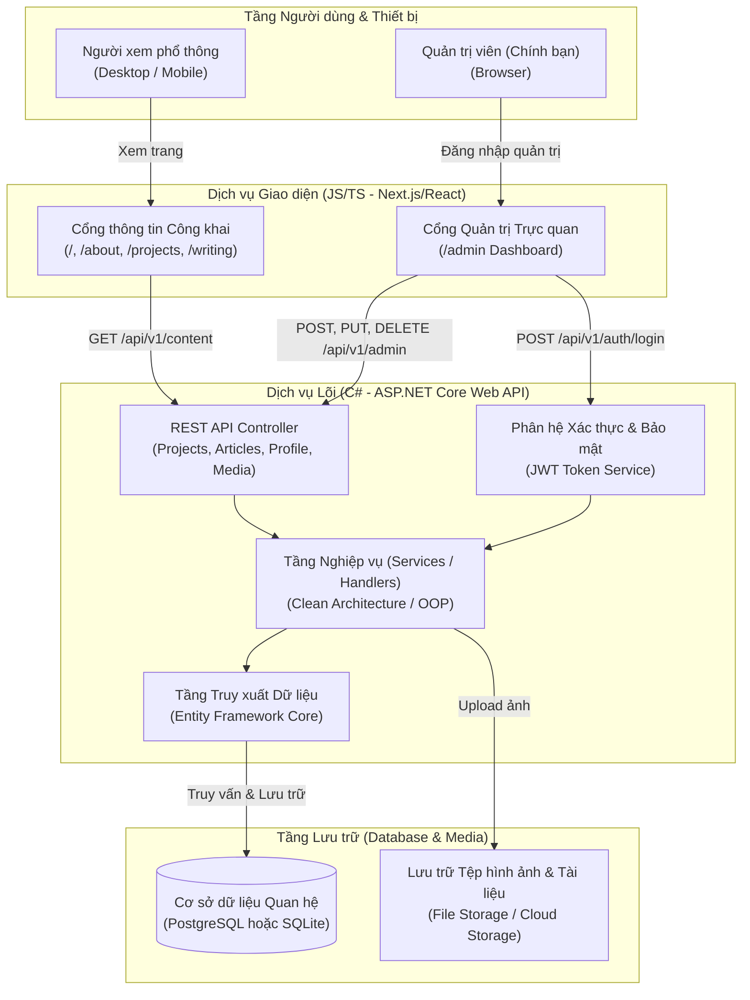

# Kiến trúc Kỹ thuật Trang web (Site Architecture)

Tài liệu này xác định kiến trúc kỹ thuật của hệ thống website cá nhân động theo mô hình **Hướng dịch vụ phân tách (Decoupled Service-Oriented Architecture)**: Backend xây dựng bằng **C# (.NET)** và Frontend xây dựng bằng **JavaScript/TypeScript**.

---

## 1. Phân định vai trò hệ thống

- **Kho lưu trữ & Tài liệu (`docs/`)**:
  - Đóng vai trò là **Bản thiết kế kỹ thuật (Engineering Blueprint)**.
  - Lưu trữ tài liệu thiết kế hệ thống, sơ đồ luồng, đặc tả API contracts, hướng dẫn triển khai.
- **Dịch vụ Backend (`backend/`)**:
  - Xây dựng bằng **C# (ASP.NET Core Web API)**.
  - Chịu trách nhiệm toàn bộ logic nghiệp vụ, quản lý dữ liệu, xác thực bảo mật và cung cấp RESTful API.
- **Ứng dụng Giao diện (`frontend/`)**:
  - Xây dựng bằng **JavaScript/TypeScript (Next.js hoặc React)**.
  - Đảm nhiệm giao diện hiển thị cho người xem và giao diện trang quản trị (`/admin`).

---

## 2. Sơ đồ Kiến trúc Hệ thống (Decoupled Architecture)

---

## 3. Chi tiết Tech Stack chuẩn hóa

### 3.1. Backend Service: C# (.NET 8/9)
- **Framework**: ASP.NET Core Web API.
- **Kiến trúc mã nguồn**: Clean Architecture hoặc Vertical Slice Architecture (đảm bảo tính đóng gói, ranh giới rõ ràng, dễ mở rộng).
- **ORM**: Entity Framework Core (EF Core) — quản lý migration và tương tác cơ sở dữ liệu mạnh mẽ, an toàn kiểu dữ liệu (type-safe).
- **Cơ sở dữ liệu**: SQLite (giai đoạn đầu, nhẹ và không cần cài server riêng) hoặc PostgreSQL (khi triển khai production).
- **Bảo mật**: JWT (JSON Web Token) cho các API quản trị (`/api/v1/admin/*`), mã hóa mật khẩu bằng BCrypt/Argon2.
- **Tài liệu API**: Tích hợp sẵn Swagger / OpenAPI UI (`/swagger`) để test và tra cứu API trực tiếp.

### 3.2. Frontend Application: JavaScript/TypeScript
- **Framework**: **Next.js** (App Router) hoặc **React** + Vite.
- **Giao tiếp API**: Axios hoặc Fetch API với kiểu dữ liệu TypeScript được đồng bộ từ Backend.
- **Styling**: Tailwind CSS — tối giản, hiện đại, hỗ trợ Dark/Light mode gốc.
- **Trình soạn thảo bài viết**: Tích hợp Markdown / TipTap editor trên trang `/admin` để bạn viết bài và format nội dung trực quan.

---

## 4. Đặc tả hợp đồng API (API Contracts Overview)

Hệ thống giao tiếp thông qua RESTful API chuẩn:

| Phương thức | Endpoint | Phân quyền | Mục đích |
| :--- | :--- | :--- | :--- |
| `POST` | `/api/v1/auth/login` | Public | Đăng nhập tài khoản quản trị viên, cấp JWT Token |
| `GET` | `/api/v1/profile` | Public | Lấy thông tin cá nhân, tiểu sử, thông điệp cốt lõi |
| `GET` | `/api/v1/projects` | Public | Lấy danh sách dự án tiêu biểu |
| `GET` | `/api/v1/projects/{slug}`| Public | Lấy chi tiết một Case Study dự án |
| `GET` | `/api/v1/articles` | Public | Lấy danh sách các bài viết / ghi chép đã xuất bản |
| `POST/PUT/DELETE` | `/api/v1/admin/projects` | **Admin Only** | Thêm, sửa, xóa dự án |
| `POST/PUT/DELETE` | `/api/v1/admin/articles` | **Admin Only** | Quản lý bài viết (Bản nháp / Xuất bản) |
| `POST` | `/api/v1/admin/media` | **Admin Only** | Tải lên hình ảnh dự án |

---

## 5. Lợi ích của kiến trúc này đối với thương hiệu cá nhân

1. **Chuẩn mực kỹ thuật cao (Industry Best-Practice)**: Tách biệt rõ ràng giữa Business Logic (C#) và Presentation Layer (JS/TS), thể hiện năng lực thiết kế hệ thống cấp độ doanh nghiệp.
2. **Khai thác trọn vẹn thế mạnh**: Bạn làm chủ logic, OOP và dữ liệu ở Backend với C#; đồng thời tận dụng hệ sinh thái phong phú của JavaScript cho giao diện web hiện đại.
3. **Dễ bảo trì và mở rộng**: Nếu sau này bạn muốn đổi giao diện web, Backend C# vẫn giữ nguyên; hoặc nếu muốn viết thêm ứng dụng Mobile (Flutter / React Native), Backend API đã sẵn sàng phục vụ mà không cần viết lại.
